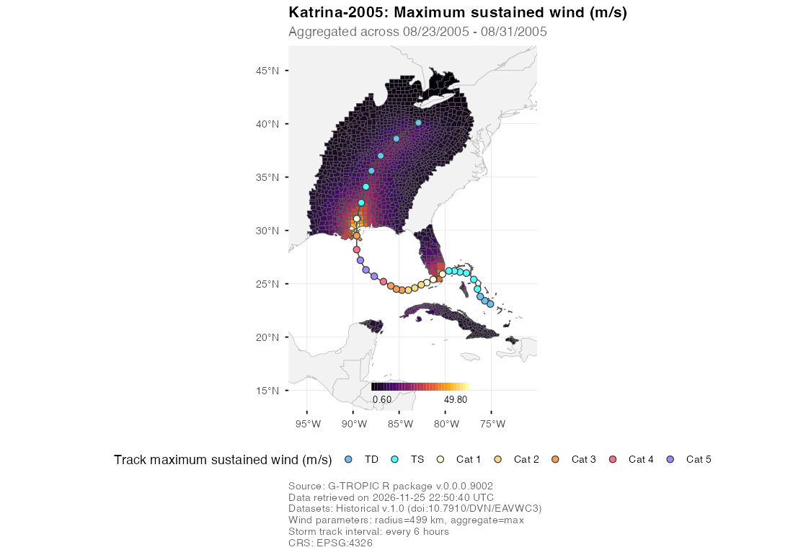

<!-- README.md is generated from README.Rmd. Please edit that file, then run
     devtools::build_readme(). -->

# gtropic 

<!-- badges: start -->

[](https://www.gnu.org/licenses/gpl-3.0)
<!-- badges: end -->

`gtropic` retrieves, filters and maps tropical cyclone exposure data
from G-TROPIC, a collection published on Harvard Dataverse and updated
weekly. It holds wind, precipitation and flood exposure for every
second-level administrative unit (ADM2) worldwide and every storm in the
International Best Track Archive for Climate Stewardship (IBTrACS) since
1980. The package returns the published values as they are and
recomputes nothing.

## Installation

Install the development version from R-universe, which provides binary
packages:

``` r
install.packages(
  "gtropic",
  repos = c("https://sparklabnyc.r-universe.dev", "https://cloud.r-project.org")
)
```

or from GitHub:

``` r
# install.packages("pak")
pak::pak("sparklabnyc/gtropic")
```

## Example

Find Hurricane Katrina, retrieve the wind exposure it caused, and map
it:

``` r
library(gtropic)

katrina_id <- gtropic_storms(STORM_NAME = "Katrina-2005")$STORM_ID
katrina <- gtropic_data(
  STORM_ID = katrina_id,
  date_range = 2005,
  tables = c("wind", "tracks", "adm2", "geometry")
)
```

``` r
katrina
#> 
#> ── G-TROPIC data ───────────────────────────────────────────────────────────────
#> • Historical dataset: doi:10.7910/DVN/EAVWC3 (version 1.0)
#> • Genesis dates: "2005-01-01" to "2005-12-31"
#> • Storms: 1
#> • ADM2 units: 1477
#> 
#> ── Tables
#> • wind: 1477 rows x 12 columns
#> • tracks: 64 rows x 10 columns
#> • storm_metadata: 1 rows x 4 columns
#> • adm2: 1477 rows x 5 columns
#> • geometry: 1477 rows x 2 columns
#> • links: 1477 rows x 12 columns
#> 
#> ℹ Use `summary()` for detail.
```

``` r
gtropic_plot(katrina)
```



A storm name such as `"Katrina-2005"` can match more than one storm, so
look it up with `gtropic_storms()` and query by the unique `STORM_ID`.

Every result carries a manifest of the exact files it used. Saved as
JSON, it replays the same retrieval later, even after the dataset has
been revised:

``` r
path <- tempfile(fileext = ".json")
gtropic_manifest_write(katrina, path)
gtropic_data(manifest = gtropic_manifest_read(path))
```

## Main functions

| Function | Purpose |
|----|----|
| `gtropic_storms()`, `gtropic_adm2()` | Look up storms and administrative units |
| `gtropic_data()` | Retrieve exposure tables for chosen storms, places and dates |
| `gtropic_plot()` | Draw static or interactive maps of a result |
| `gtropic_manifest_write()`, `gtropic_manifest_read()` | Save a retrieval and replay it |
| `gtropic_cache_list()`, `gtropic_cache_prune()` | Inspect and tidy the download cache |

## Learn more

- [Getting
  started](https://sparklabnyc.github.io/gtropic/articles/getting-started.html):
  a first query and what it returns.
- [Filtering](https://sparklabnyc.github.io/gtropic/articles/filtering.html):
  how place, date and storm filters combine.
- [Linkage](https://sparklabnyc.github.io/gtropic/articles/linkage.html):
  joining precipitation and flood records to storms without double
  counting.
- [Plotting](https://sparklabnyc.github.io/gtropic/articles/plotting.html):
  static and interactive maps.
- [Versions and
  caching](https://sparklabnyc.github.io/gtropic/articles/versions-and-caching.html):
  reproducible retrieval and the download cache.

## Citation

Please cite both the package and the G-TROPIC datasets. The dataset DOIs
and versions behind a result are listed by `gtropic_manifest()`.
