``` r
library(gtropic)
```

Each map below is drawn from one of two retrievals, with the code that
draws it. `vignette("plotting", package = "gtropic")` explains the arguments.


``` r
katrina_id <- gtropic_storms(STORM_NAME = "Katrina-2005")$STORM_ID
katrina <- gtropic_data(STORM_ID = katrina_id, date_range = 2005)
#> Warning in fetch_hazards(args, ctx, scope, date_spec): No non-missing precipitation values were returned for 15 selected ADM2 units.
#> ! "86173395B10183828018242", "86173395B33619167853359",
#>   "86173395B49833060083827", "86173395B5227574641069",
#>   "86173395B64443584385378", "86173395B69111748421310",
#>   "86173395B71884173217057", "86173395B8049186625596",
#>   "86173395B80884224234425", "86173395B82868545095992", and "... and 5 more"
#> ℹ A known current source-data limitation can affect small or coastal ADM2 units
#>   when no ERA5-Land grid cell is assigned.
#> ℹ A future G-TROPIC dataset release is planned to fill these gaps using
#>   finer-resolution ERA5 precipitation data.
#> ℹ See `?gtropic_known_limitations`; complete identifiers are available from
#>   `gtropic_diagnostics()`.
india_19 <- gtropic_data(WHO_ENTITY = "India", date_range = 2019)
#> Warning in fetch_hazards(args, ctx, scope, date_spec): No non-missing precipitation values were returned for 2 selected ADM2 units.
#> ! "76128533B41477629049356" and "76128533B56857410767766"
#> ℹ A known current source-data limitation can affect small or coastal ADM2 units
#>   when no ERA5-Land grid cell is assigned.
#> ℹ A future G-TROPIC dataset release is planned to fill these gaps using
#>   finer-resolution ERA5 precipitation data.
#> ℹ See `?gtropic_known_limitations`; complete identifiers are available from
#>   `gtropic_diagnostics()`.
```

## Aggregation

Total precipitation over each unit's window, against its largest single-day
total:


``` r
gtropic_plot(katrina, metric = "PRECIP_MM", aggregate = "sum")
```

<div class="figure">
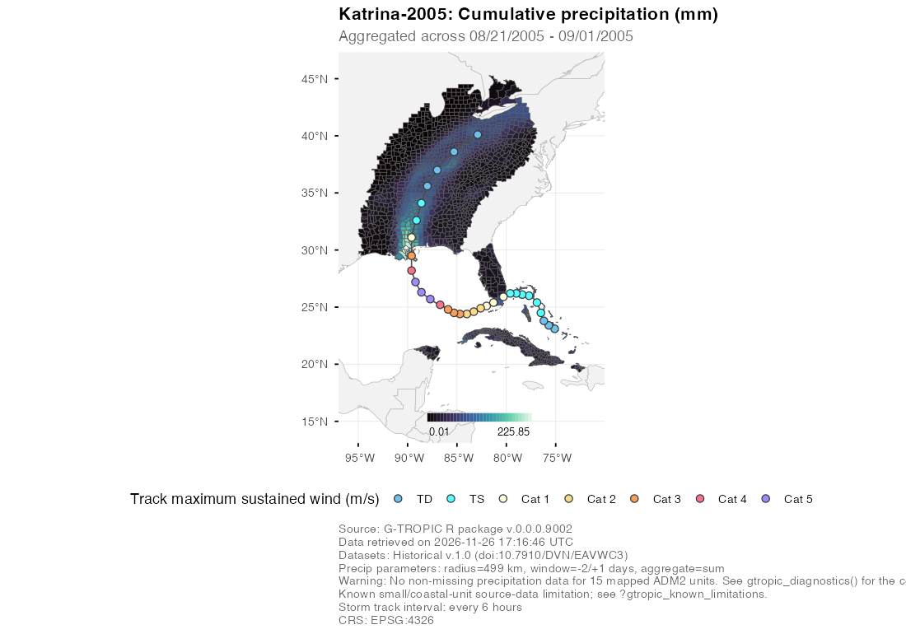
<p class="caption">plot of chunk katrina-precip-total</p>
</div>


``` r
gtropic_plot(katrina, metric = "PRECIP_MM", aggregate = "max")
```

<div class="figure">
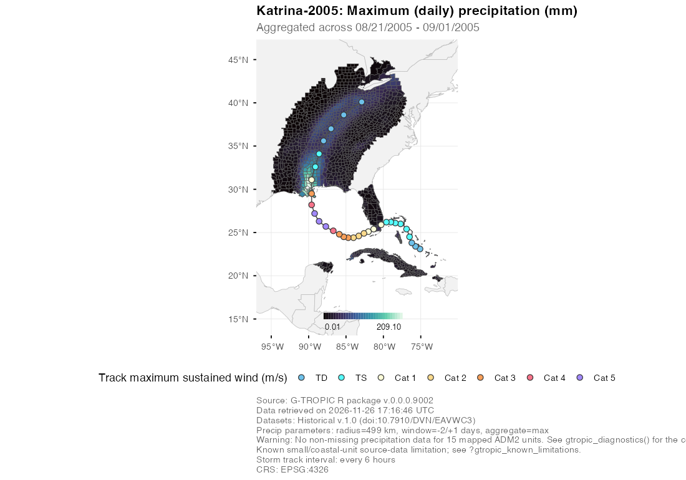
<p class="caption">plot of chunk katrina-precip-max</p>
</div>

## Choosing metrics

Three measures of wind speed:


``` r
gtropic_plot(
  katrina,
  metric = c("VMAX_SUST_MS", "VMAX_GUST_MS", "WIND_RADII_VMAX_SUST_MS")
)
```

<div class="figure">
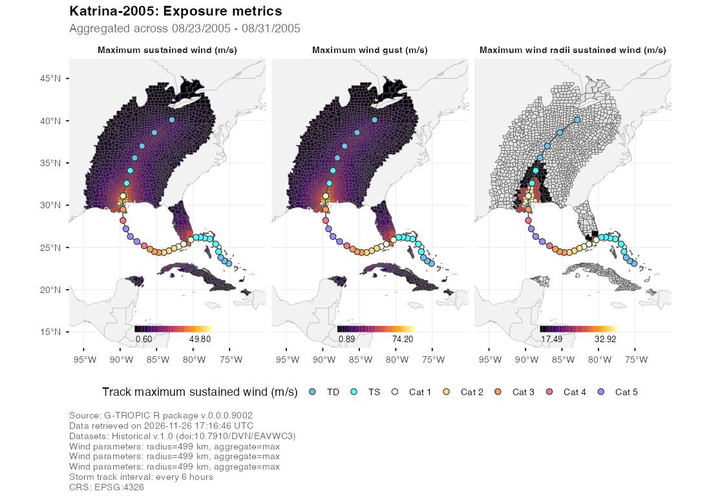
<p class="caption">plot of chunk katrina-wind-metrics</p>
</div>

Three measures of how long the wind lasted:


``` r
gtropic_plot(
  katrina,
  metric = c("SUST_DUR_MINUTES", "GUST_DUR_MINUTES", "WIND_RADII_SUST_DUR_MINUTES")
)
```

<div class="figure">
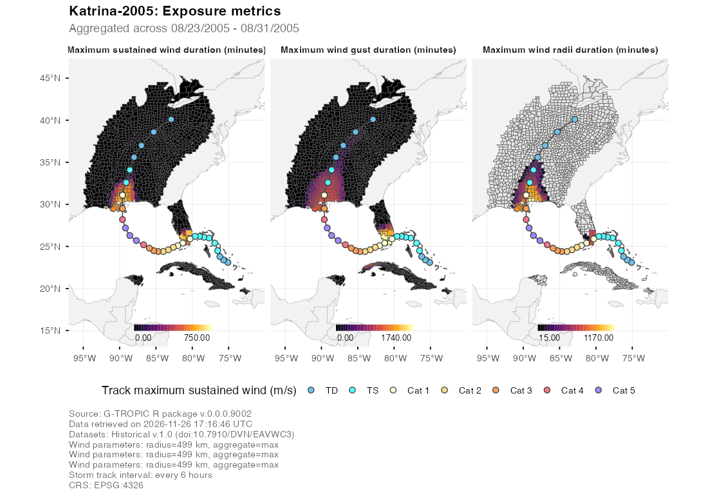
<p class="caption">plot of chunk katrina-wind-durations</p>
</div>

Two metrics with their own aggregation and palette, on a basemap of
first-level administrative boundaries (needs the `rnaturalearthhires`
package):


``` r
gtropic_plot(
  katrina,
  metric = c("VMAX_SUST_MS", "PRECIP_MM"),
  aggregate = c("max", "sum"),
  palette = c("inferno", "mako"),
  track = FALSE,
  basemap = "admin1"
)
```

<div class="figure">
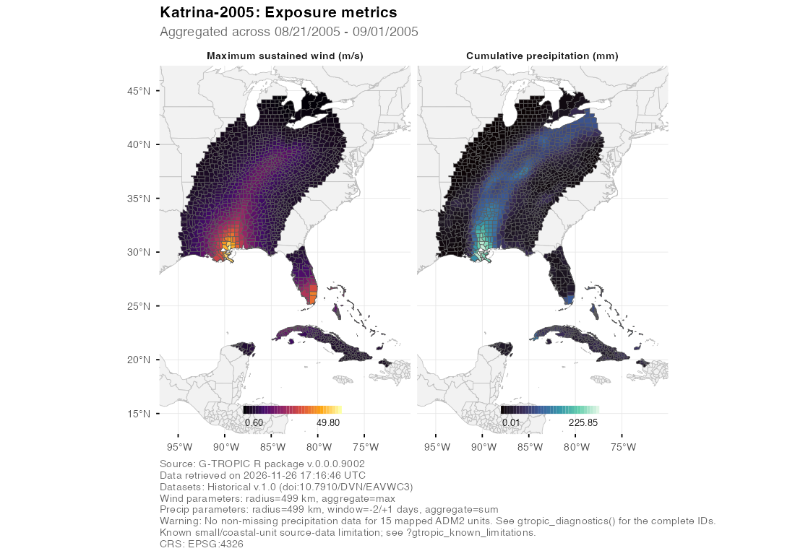
<p class="caption">plot of chunk multi-metric-map</p>
</div>

## A custom category key

Two classes, below and at hurricane force:


``` r
two_class_wind <- data.frame(
  category = c("Below hurricane", "Hurricane-force"),
  threshold = c(32, Inf),
  unit = "m/s",
  color = c("#9ECAE1", "#DE2D26")
)

gtropic_plot(
  katrina,
  metric = "VMAX_SUST_MS",
  wind_categories = two_class_wind,
  track = FALSE
)
```

<div class="figure">
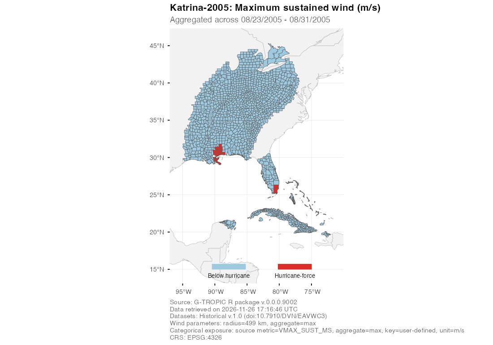
<p class="caption">plot of chunk katrina-two-class</p>
</div>

## Several storms

The tracks of the 2019 storms near India:


``` r
gtropic_plot(india_19, type = "track")
```

<div class="figure">
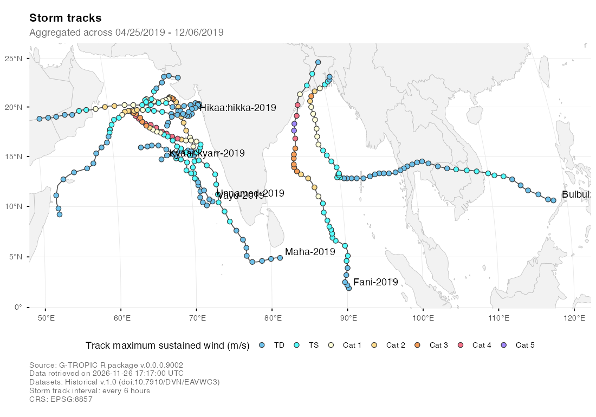
<p class="caption">plot of chunk india-tracks</p>
</div>

The largest sustained wind each unit received from any of them, with their
tracks:


``` r
gtropic_plot(india_19, metric = "VMAX_SUST_MS", track_labels = FALSE)
```

<div class="figure">
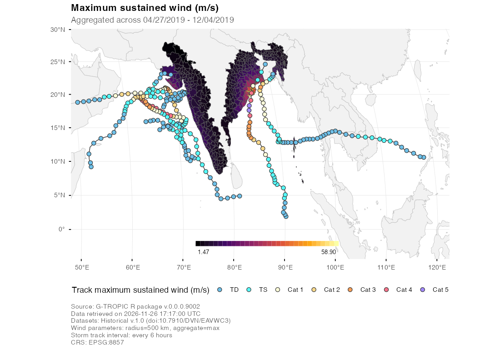
<p class="caption">plot of chunk multi-storm-exposure</p>
</div>

Without tracks:


``` r
gtropic_plot(india_19, metric = "VMAX_SUST_MS", track = FALSE)
```

<div class="figure">
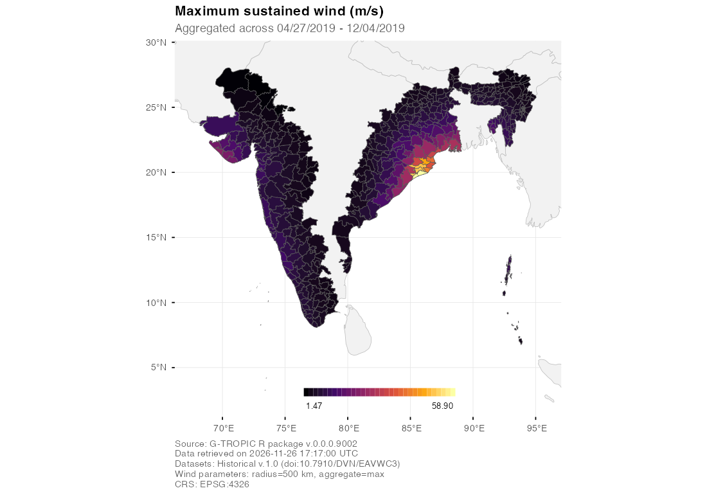
<p class="caption">plot of chunk multi-storm-no-tracks</p>
</div>

Zoomed in with `bbox`:


``` r
gtropic_plot(
  india_19,
  metric = "VMAX_SUST_MS",
  track = FALSE,
  bbox = c(xmin = 82.5, ymin = 17.5, xmax = 87.7, ymax = 25),
  expand = 0
)
```

<div class="figure">
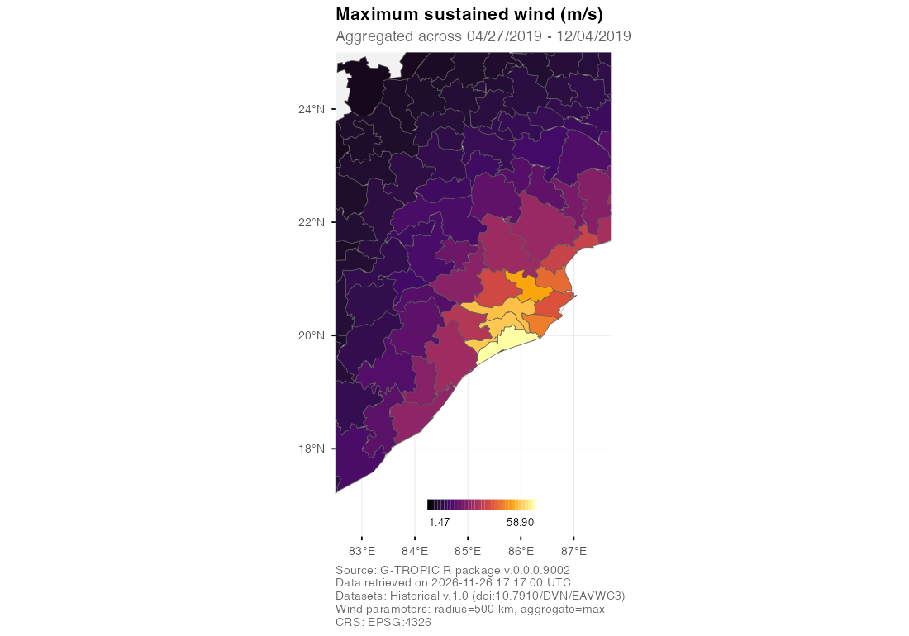
<p class="caption">plot of chunk multi-storm-zoom</p>
</div>

## Count maps

Storms instead of days:


``` r
gtropic_plot(india_19, type = "count", count_unit = "storms", track = FALSE)
```

<div class="figure">
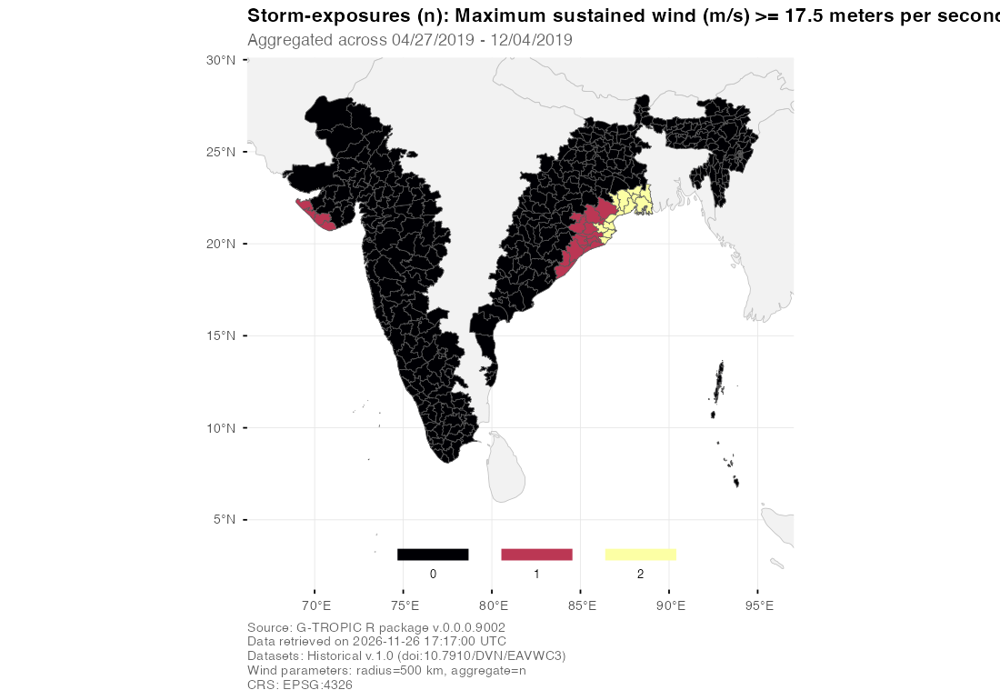
<p class="caption">plot of chunk count-map-storms</p>
</div>

Days with any sustained wind, and days with at least 10 mm of precipitation:


``` r
gtropic_plot(
  india_19,
  type = "count",
  metric = c("VMAX_SUST_MS", "PRECIP_MM"),
  count_unit = "days",
  threshold = list(VMAX_SUST_MS = 0, PRECIP_MM = 10),
  track = FALSE
)
```

<div class="figure">
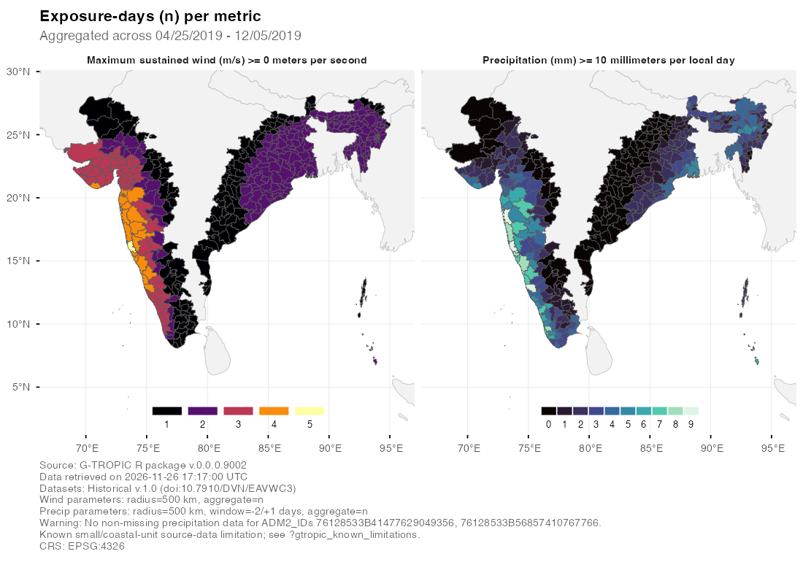
<p class="caption">plot of chunk count-map-thresholds</p>
</div>
