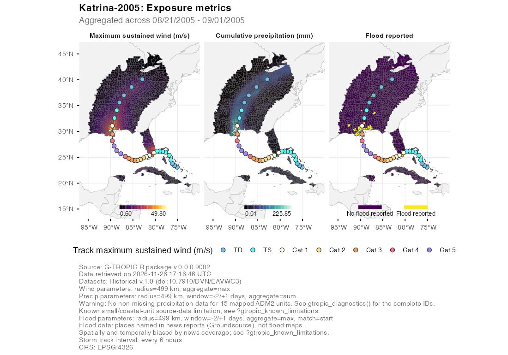
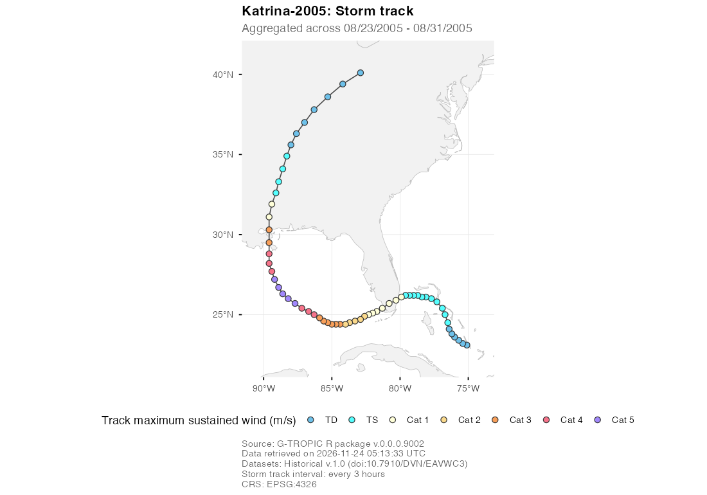
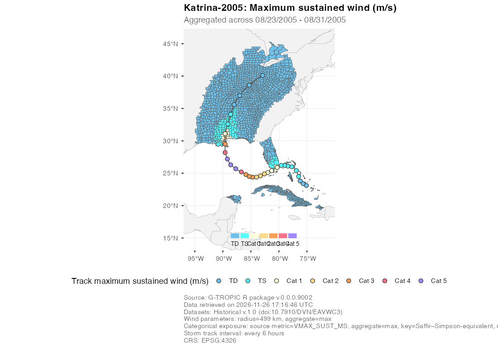
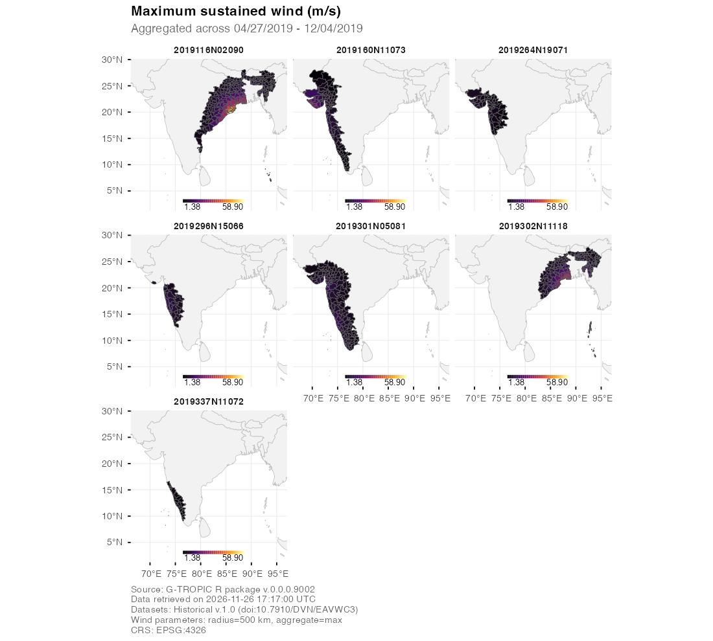
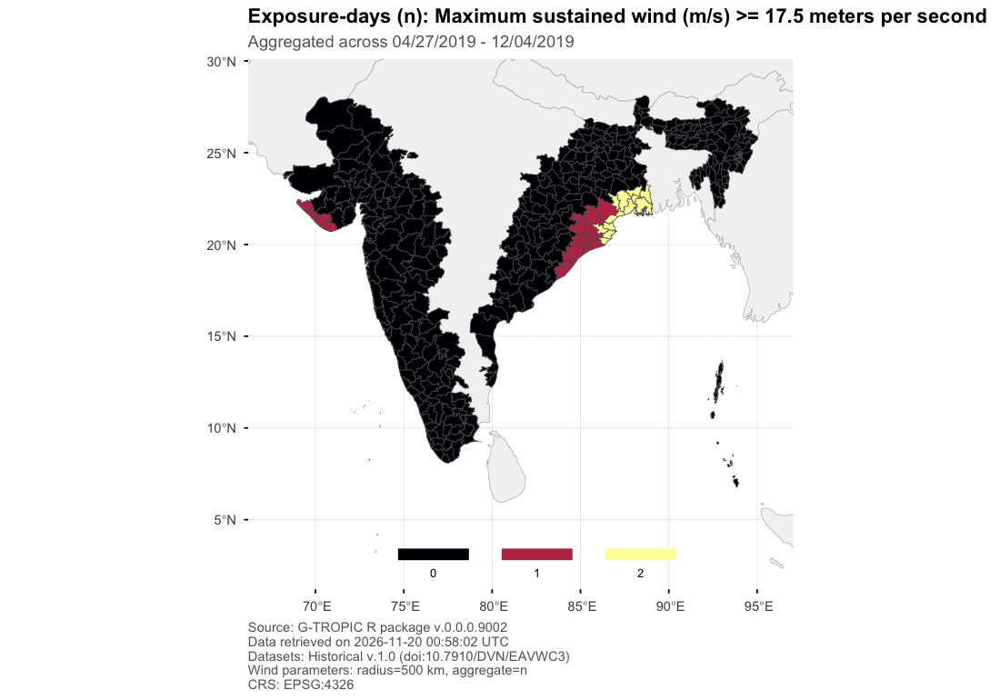

``` r
library(gtropic)
```

`gtropic_plot()` turns a `gtropic_data()` result into static exposure, count
and track maps, or interactive exposure and count maps. It never downloads
data or recomputes published values. This vignette shows five maps; the
[plot gallery](https://sparklabnyc.github.io/gtropic/articles/plot-gallery.html) on the package website shows many more
variations, each with its code.

## A single storm

Look Hurricane Katrina up by name, then retrieve it by its unique `STORM_ID`
(a name such as `"Katrina-2005"` can match more than one storm):


``` r
katrina_id <- gtropic_storms(STORM_NAME = "Katrina-2005")$STORM_ID
katrina <- gtropic_data(STORM_ID = katrina_id, date_range = 2005)
#> Retrieving 0 files (0.0 B); 10 already cached.
#> Warning in fetch_hazards(args, ctx, scope, date_spec): No non-missing precipitation values were returned for 15 selected ADM2 units.
#> ! "86173395B10183828018242", "86173395B33619167853359",
#>   "86173395B49833060083827", "86173395B5227574641069",
#>   "86173395B64443584385378", "86173395B69111748421310",
#>   "86173395B71884173217057", "86173395B8049186625596",
#>   "86173395B80884224234425", "86173395B82868545095992", and "... and 5 more"
#> ℹ A known current source-data limitation can affect small or coastal ADM2 units
#>   when no ERA5-Land grid cell is assigned.
#> ℹ A future G-TROPIC dataset release is planned to fill these gaps using
#>   finer-resolution ERA5 precipitation data.
#> ℹ See `?gtropic_known_limitations`; complete identifiers are available from
#>   `gtropic_diagnostics()`.
```

### Exposure maps

The default is an exposure map with a panel for each core metric: maximum
sustained wind (`VMAX_SUST_MS`), total precipitation (`PRECIP_MM`) and
largest flooded share (`PROP_FLOODED_AREA`).


``` r
gtropic_plot(katrina)
```

<div class="figure">

<p class="caption">plot of chunk katrina-exposure</p>
</div>

`gtropic_metrics()` lists every metric that can be mapped and how it is
aggregated per unit by default:


``` r
gtropic_metrics()
#> $wind
#> # A tibble: 6 × 5
#>   metric                      label               unit  aggregate plot_supported
#>   <chr>                       <chr>               <chr> <chr>     <lgl>
#> 1 VMAX_SUST_MS                Maximum sustained … m/s   max       TRUE
#> 2 VMAX_GUST_MS                Maximum wind gust … m/s   max       TRUE
#> 3 SUST_DUR_MINUTES            Sustained wind dur… minu… max       TRUE
#> 4 GUST_DUR_MINUTES            Wind gust duration… minu… max       TRUE
#> 5 WIND_RADII_VMAX_SUST_MS     Wind radii sustain… m/s   max       TRUE
#> 6 WIND_RADII_SUST_DUR_MINUTES Wind radii duratio… minu… max       TRUE
#>
#> $precip
#> # A tibble: 1 × 5
#>   metric    label              unit  aggregate plot_supported
#>   <chr>     <chr>              <chr> <chr>     <lgl>
#> 1 PRECIP_MM Precipitation (mm) mm    sum       TRUE
#>
#> $flood
#> # A tibble: 3 × 5
#>   metric               label                      unit  aggregate plot_supported
#>   <chr>                <chr>                      <chr> <chr>     <lgl>
#> 1 PROP_FLOODED_POP     Flooded population (propo… prop… max       TRUE
#> 2 PROP_FLOODED_AREA    Flooded area (proportion,… prop… max       TRUE
#> 3 FLOODED_POP_CENTROID Flooded population centro… logi… any       FALSE
```

`metric` chooses the metrics, one panel each, and `aggregate` overrides how
each is summarised per unit; `metric`, `aggregate`, `palette` and `direction`
take vectors aligned by position, so each panel keeps its own scale.
`?gtropic_plot` lists the other settings, such as `basemap`, `bbox` and `crs`.

### Track maps

`type = "track"` draws only the storm track. Points are coloured by the
Saffir-Simpson categories of `gtropic_saffir_simpson()`, in metres per second;
`track_map_key` takes another key, and `track_interval` shows points every
three or six hours while the path keeps every observation:


``` r
gtropic_plot(katrina, type = "track", track_interval = 3)
```

<div class="figure">

<p class="caption">plot of chunk katrina-track</p>
</div>

### Categorical maps

`wind_categories` sorts units into classes by the wind they received, using a
key like the one `gtropic_saffir_simpson()` returns:


``` r
gtropic_saffir_simpson()
#> # A tibble: 7 × 4
#>   category threshold unit  color
#>   <chr>        <dbl> <chr> <chr>
#> 1 TD              17 m/s   #6EC1EA
#> 2 TS              32 m/s   #55FFFF
#> 3 Cat 1           42 m/s   #FFFFD9
#> 4 Cat 2           49 m/s   #FBDA8C
#> 5 Cat 3           58 m/s   #F89F59
#> 6 Cat 4           70 m/s   #F6738A
#> 7 Cat 5          Inf m/s   #A188FC
```


``` r
gtropic_plot(
  katrina,
  metric = "VMAX_SUST_MS",
  wind_categories = gtropic_saffir_simpson()
)
```

<div class="figure">

<p class="caption">plot of chunk katrina-categories</p>
</div>

The Saffir-Simpson key is allowed only for `VMAX_SUST_MS` with
`aggregate = "max"`, where it describes local sustained wind, not storm
status. Other metrics and aggregates need a custom key with `category`,
`threshold`, `unit` and `color` columns. Categories must be unique, thresholds
are increasing upper bounds ending in `Inf` (a value equal to a threshold
belongs to that category), and `unit` is one value matching the metric's unit
(`"m/s"` and `"meters per second"` both work). With several metrics, pass a
list of keys named by metric. The gallery has a two-class example.

### Interactive maps

`interactive = TRUE` returns a Leaflet exposure or count map. It uses vector
layers and needs no tile-server key.


``` r
gtropic_plot(katrina, interactive = TRUE, basemap = "none")
```

## Several storms

The storms of 2019 that came within 500 km of a unit in India:


``` r
india_19 <- gtropic_data(WHO_ENTITY = "India", date_range = 2019)
#> Retrieving 0 files (0.0 B); 10 already cached.
#> Warning in fetch_hazards(args, ctx, scope, date_spec): No non-missing precipitation values were returned for 2 selected ADM2 units.
#> ! "76128533B41477629049356" and "76128533B56857410767766"
#> ℹ A known current source-data limitation can affect small or coastal ADM2 units
#>   when no ERA5-Land grid cell is assigned.
#> ℹ A future G-TROPIC dataset release is planned to fill these gaps using
#>   finer-resolution ERA5 precipitation data.
#> ℹ See `?gtropic_known_limitations`; complete identifiers are available from
#>   `gtropic_diagnostics()`.

india_19$storm_metadata
#> # A tibble: 7 × 4
#>   STORM_ID      STORM_NAME        USA_ATCF_ID STORM_GENESIS_DATE_UTC
#>   <chr>         <chr>             <chr>       <date>
#> 1 2019116N02090 Fani-2019         IO012019    2019-04-25
#> 2 2019160N11073 Vayu-2019         IO022019    2019-06-08
#> 3 2019264N19071 Hikaa:hikka-2019  IO032019    2019-09-20
#> 4 2019296N15066 Kyaar:kyarr-2019  IO042019    2019-10-22
#> 5 2019301N05081 Maha-2019         IO052019    2019-10-28
#> 6 2019302N11118 Bulbul:matmo-2019 WP232019    2019-10-28
#> 7 2019337N11072 Unnamed-2019      IO072019    2019-12-02
```

The largest sustained wind each unit received from each storm, one panel per
storm (`facet_by` draws a panel for each value of a column):


``` r
gtropic_plot(
  india_19,
  metric = "VMAX_SUST_MS",
  facet_by = "STORM_ID",
  track = FALSE
)
```

<div class="figure">

<p class="caption">plot of chunk facet-by-storm</p>
</div>

### Count maps

Count maps count, per unit, the storms or local days on which a metric met its
threshold; `count_unit` chooses which, and `threshold` changes the
definitions. The caption records the definitions used.


``` r
gtropic_plot(india_19, type = "count", count_unit = "days", track = FALSE)
```

<div class="figure">

<p class="caption">plot of chunk count-map</p>
</div>

## Saving plots

Add ggplot2 layers to a static map, then save it with `gtropic_save()`.


``` r
p <- gtropic_plot(katrina, metric = "VMAX_SUST_MS", basemap = "none") +
  theme_gtropic(base_size = 11)

gtropic_save(p, "katrina-wind-exposure.png", dpi = 300)
```

## Summary

- Metrics, aggregation, category keys, thresholds and the map extent make a
  map's exposure definition explicit, and its caption records it.
- Static maps are ggplot objects; exposure and count maps can be interactive.


## Where to go next

- `vignette("getting-started")`: a first query and what it returns.
- `vignette("filtering")`: how place, date and storm filters combine.
- `vignette("linkage")`: joining precipitation and flood records to storms
  without double counting.
- `vignette("plotting")`: exposure, count and track maps.
- `vignette("versions-and-caching")`: manifests, dataset versions and the
  download cache.
- [Data sources](https://sparklabnyc.github.io/gtropic/articles/data-sources.html)
  and the [plot gallery](https://sparklabnyc.github.io/gtropic/articles/plot-gallery.html)
  on the package website.
