``` r
library(gtropic)
```

This vignette covers how to use the `gtropic_plot()` function to turn the exposure data
tables returned by `gtropic_data()` into static
exposure maps, exposure-count maps, and storm-track maps, as well as
interactive exposure and count maps.

## Plotting a single storm

Let's begin by plotting Hurricane Katrina (2005):


``` r
katrina <- gtropic_data(
  STORM_NAME = "Katrina-2005"
)
#> Discovering datasets in collection "gtropic".
#> Retrieving 0 files (0.0 B) ; 10 already cached.
```

With the default 500 km radii applied to the wind, precipitation, and flood fields,
the data we get back will only include those ADM2s within 500km of Katrina's storm track.
We're also implicitly using the default precipitation and flood temporal windows (-2/+1 days).

### Exposure maps

When we call the `gtropic_plot()` function and pass in `katrina`, the default caption
that gets rendered reminds us of this by examining the data present in `katrina`:


``` r
gtropic_plot(katrina)
```

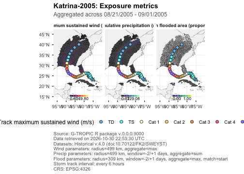

Specifying none of the optional arguments by default renders an exposure map (implicitly, `type = "exposure"`),
summarizing a selected published metric for each ADM2. With
`type = "exposure"` and no provided `metric`, the default is every available core metric
in this order: maximum sustained wind (`VMAX_SUST_MS`), cumulative precipitation
(`PRECIP_MM`), and maximum flooded area (`PROP_FLOODED_AREA`). This makes the
default plot a multi-panel overview rather than a single-metric map.
To see a list of all the available exposure metrics
and how they are summarized for plotting, we can call:


``` r
gtropic_exposures()
#> $wind
#> # A tibble: 6 × 5
#>   metric                      label               unit  aggregate plot_supported
#>   <chr>                       <chr>               <chr> <chr>     <lgl>
#> 1 VMAX_SUST_MS                Maximum sustained … m/s   max       TRUE
#> 2 VMAX_GUST_MS                Maximum wind gust … m/s   max       TRUE
#> 3 SUST_DUR_MINUTES            Sustained wind dur… minu… max       TRUE
#> 4 GUST_DUR_MINUTES            Wind gust duration… minu… max       TRUE
#> 5 WIND_RADII_VMAX_SUST_MS     Wind radii sustain… m/s   max       TRUE
#> 6 WIND_RADII_SUST_DUR_MINUTES Wind radii duratio… minu… max       TRUE
#>
#> $precip
#> # A tibble: 1 × 5
#>   metric    label              unit  aggregate plot_supported
#>   <chr>     <chr>              <chr> <chr>     <lgl>
#> 1 PRECIP_MM Precipitation (mm) mm    sum       TRUE
#>
#> $flood
#> # A tibble: 3 × 5
#>   metric               label                      unit  aggregate plot_supported
#>   <chr>                <chr>                      <chr> <chr>     <lgl>
#> 1 PROP_FLOODED_POP     Flooded population (propo… prop… max       TRUE
#> 2 PROP_FLOODED_AREA    Flooded area (proportion,… prop… max       TRUE
#> 3 FLOODED_POP_CENTROID Flooded population centro… logi… any       FALSE
```

The `metric` column let's us know the available exposures, and the `aggregate` column
informs us how that metric is summarized when plotted. For example, the `PRECIP_MM` metric has
a default aggregate value of `sum`, meaning our plot visualizes the sum of each ADM2's
precipitation data over the temporal window present the `$precip` data table we passed in
to the plotting function as part of `katrina`.

We can override how exposures are summarized
using the `aggregate` argument of the plotting function. For instance,
let's compare plots showing each ADM2's total precipitation recorded in our temporal window,


``` r
gtropic_plot(
  katrina,
  metric = "PRECIP_MM",
  aggregate = "sum"
)
```

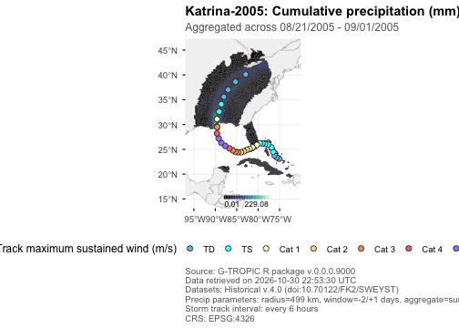

versus their maximum daily precipitation:


``` r
gtropic_plot(
  katrina,
  metric = "PRECIP_MM",
  aggregate = "max"
)
```

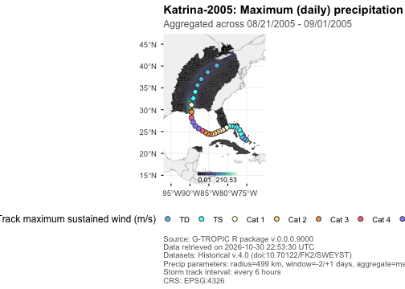

We can also swap out which exposure metrics we want to visualize:


``` r
gtropic_plot(
  katrina,
  metric = c("VMAX_SUST_MS", "VMAX_GUST_MS", "WIND_RADII_VMAX_SUST_MS"),
)
```

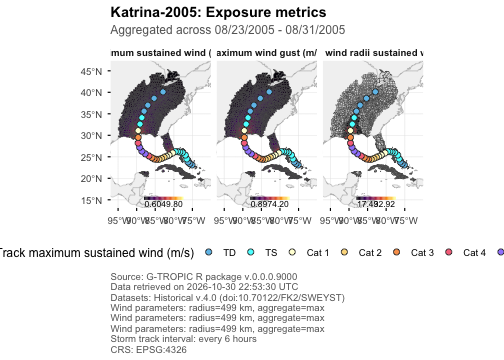


``` r
gtropic_plot(
  katrina,
  metric = c("SUST_DUR_MINUTES", "GUST_DUR_MINUTES", "WIND_RADII_SUST_DUR_MINUTES"),
)
```

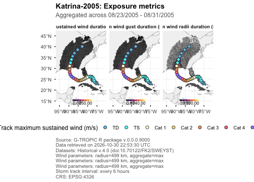

Take a look at the help page for the plotting function with `?gtropic_plot` to examine other elements of the
map you can manipulate, for example, the `basemap`, or color `palette`.

The `metric`, `aggregate`, `palette`, and `direction` accept vectors aligned by
position. This makes a panel for each selected metric while preserving a
separate, hazard-appropriate scale for every panel.


``` r
gtropic_plot(
  katrina,
  type = "exposure",
  metric = c("VMAX_SUST_MS", "PRECIP_MM"),
  aggregate = c("max", "sum"),
  palette = c("inferno", "mako"),
  direction = c(1, 1),
  track = FALSE,
  basemap = "admin1"
)
```

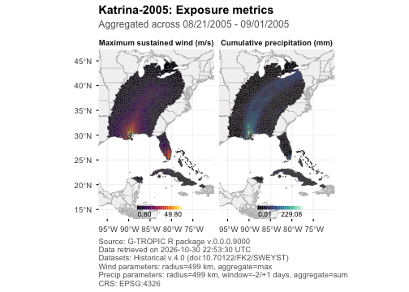

### Track maps

If we're only interested in visualizing the storm track, then we can set
`type = "track"`:


``` r
gtropic_plot(
  katrina,
  type = "track",
  basemap = "admin1",
  track_map_key = saffir_simpson(),
  track_interval = 3,
)
```

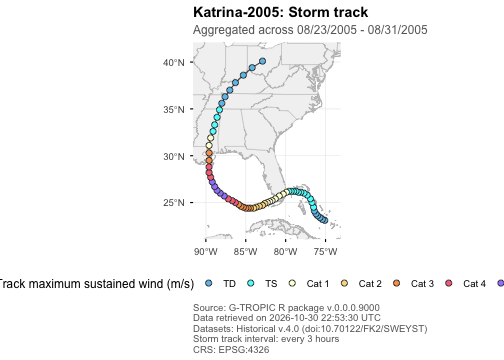

By default, their points
are classified with `saffir_simpson()`, which returns the conventional
Saffir-Simpson category key in meters per second. Supply a compatible data frame
to `track_map_key` to use a different classification, and use `track_interval`
to sample displayed points at three- or six-hour UTC intervals while retaining
the complete path. Static wind legends always show every category in the supplied
key, even when no displayed track observation falls in a category.

### Categorical ADM2 maps


If you'd like to categorize ADM2s into buckets defined by the wind they've been exposed to, you can use the
`wind_categories` argument and pass in a table that looks like the one returned by
`saffir_simpson()`:


``` r
saffir_simpson()
#> # A tibble: 7 × 4
#>   category threshold unit  color
#>   <chr>        <dbl> <chr> <chr>
#> 1 TD              17 m/s   #6EC1EA
#> 2 TS              32 m/s   #5FF
#> 3 Cat 1           42 m/s   #FFFFD9
#> 4 Cat 2           49 m/s   #FBDA8C
#> 5 Cat 3           58 m/s   #F89F59
#> 6 Cat 4           70 m/s   #F6738A
#> 7 Cat 5          Inf m/s   #A188FC
```


``` r
gtropic_plot(katrina, wind_categories = saffir_simpson())
#> Error in `plot_resolve_wind_categories()`:
#> ! A bare `wind_categories` key requires exactly one selected metric.
#> ℹ For multiple metrics, supply a named list keyed by metric.
```

The `wind_categories` argument classifies aggregated ADM2 wind exposure rather than drawing
it on a continuous scale. It applies to non-binary exposure maps for metrics in
the wind table, including interactive maps. For multiple selected metrics, use a named list keyed by the
selected wind metric or metrics to classify; metrics without a supplied key
retain their continuous fill. The built-in `saffir_simpson()` key is permitted
only for `VMAX_SUST_MS` with `aggregate = "max"`; it represents a local
sustained-wind equivalent, not storm status. Use an explicitly custom key for
other wind metrics or aggregations.

Custom category keys use `category`, `threshold`, `unit`, and `color` columns.
Categories must be unique; thresholds are strictly increasing
upper bounds ending in `Inf`; and `unit` must be one arbitrary, nonempty,
consistent value matching the source metric's unit. Conventional spellings of
meters per second, such as `m/s` and `meters per second`, are treated as
compatible.
Values equal to a threshold belong to that category. Unlike `track_map_key`,
categorical exposure keys are not limited to a fixed set of track-wind units.
For example, this two-class key is intentionally coarse:


``` r
two_class_wind <- data.frame(
  category = c("Below hurricane", "Hurricane-force"),
  threshold = c(32, Inf),
  unit = "m/s",
  color = c("#9ECAE1", "#DE2D26")
)

gtropic_plot(
  katrina,
  metric = "VMAX_SUST_MS",
  wind_categories = two_class_wind,
  track = FALSE
)
```

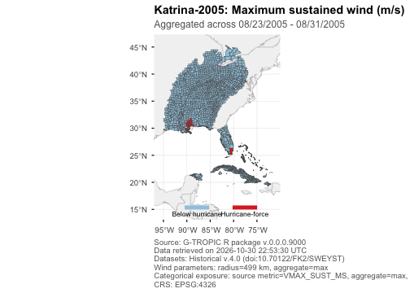

### Interactive maps

Set `interactive = TRUE` for a Leaflet exposure or count map. Interactive maps
use vector layers and do not require a tile-server API key. Static gridlines do
not apply to this output because Leaflet maps have no plot axes.


``` r
gtropic_plot(
  katrina,
  interactive = TRUE,
  basemap = "none"
)
```

## Plotting multiple storms

Now let's plot all the storms whose genesis date fell inside 2019, coming within 500km of India:


``` r
india_19 <- gtropic_data(
  WHO_ENTITY = "India",
  date_range = c(2019, 2019)
)
#> Discovering datasets in collection "gtropic".
#> Retrieving 0 files (0.0 B) ; 10 already cached.

india_19$storm_metadata
#> # A tibble: 7 × 4
#>   STORM_ID      STORM_NAME        USA_ATCF_ID STORM_GENESIS_DATE_UTC
#>   <chr>         <chr>             <chr>       <date>
#> 1 2019116N02090 Fani-2019         IO012019    2019-04-25
#> 2 2019160N11073 Vayu-2019         IO022019    2019-06-08
#> 3 2019264N19071 Hikaa:hikka-2019  IO032019    2019-09-20
#> 4 2019296N15066 Kyaar:kyarr-2019  IO042019    2019-10-22
#> 5 2019301N05081 Maha-2019         IO052019    2019-10-28
#> 6 2019302N11118 Bulbul:matmo-2019 WP232019    2019-10-28
#> 7 2019337N11072 Unnamed-2019      IO072019    2019-12-02
```


``` r
gtropic_plot(india_19, type = "track")
```

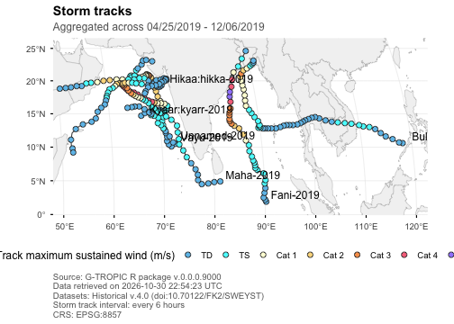

Let's look at the maximum sustained winds each ADM2 was exposed to as a result of these storms:

``` r
gtropic_plot(india_19, metric = "VMAX_SUST_MS", track_labels = FALSE)
```

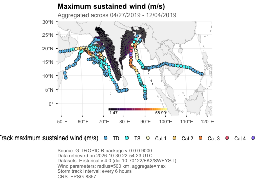

Or if the tracks are making it difficult for us to see the data clearly:

``` r
gtropic_plot(india_19, metric = "VMAX_SUST_MS", track = FALSE)
```

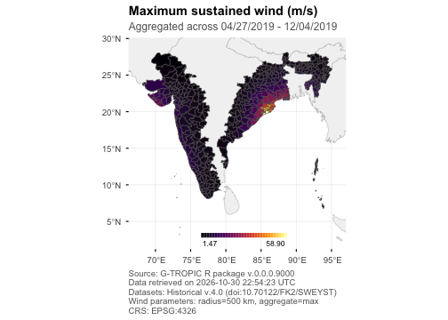

We can use the `bbox` argument to zoom in on a region of interest:

``` r
gtropic_plot(
  india_19,
  metric = "VMAX_SUST_MS",
  track = FALSE,
  bbox = c(xmin = 82.5, xmax = 87.7, ymin = 17.5, ymax = 25),
  expand = 0
)
```

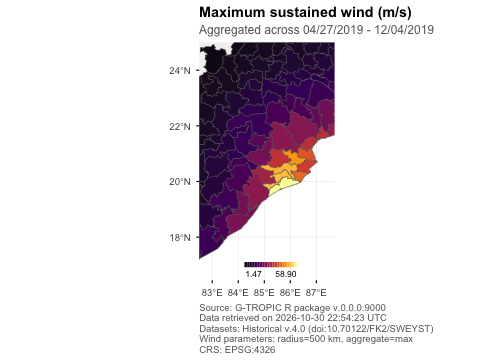

### Count maps

Count maps apply metric-specific thresholds before counting the number of distinct
storms or local exposure days that meet those thresholds.
The automatic caption records the selected definitions.


``` r
gtropic_plot(
  india_19,
  type = "count",
  count_unit = "days",
  track = FALSE
)
```

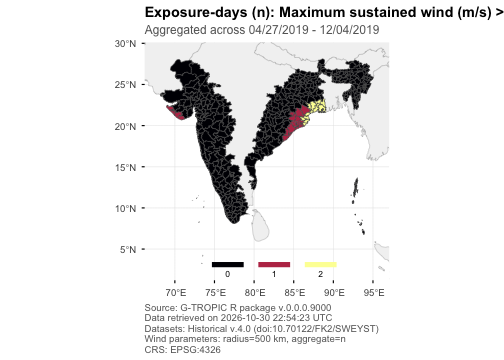


``` r
gtropic_plot(
  india_19,
  type = "count",
  count_unit = "storms",
  track = FALSE
)
```

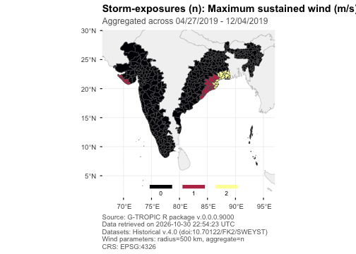

We can use the `threshold` argument to change how we define an exposure:

``` r
gtropic_plot(
  india_19,
  type = "count",
  metric = c("VMAX_SUST_MS", "PRECIP_MM"),
  count_unit = "days",
  threshold = list(VMAX_SUST_MS = 0, PRECIP_MM = 10),
  track = FALSE
)
```

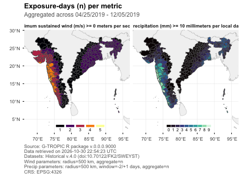

## Saving plots

Static calls return ggplot objects, which can be extended with ggplot2 layers
and saved with `gtropic_save()` when the analysis is ready for publication.


``` r
p <- gtropic_plot(
  katrina,
  type = "exposure",
  metric = "VMAX_SUST_MS",
  storm = "Katrina-2005",
  basemap = "none"
) + theme_gtropic(base_size = 11)

gtropic_save(p, "katrina-wind-exposure.png", dpi = 300)
```

## Summary

- `gtropic_plot()` produces exposure, count, and track maps directly from a
  `gtropic_data` object.
- Select metrics, aggregation methods, category keys, map extent, and track
  options to make the displayed exposure definition explicit.
- Static plots can be extended with ggplot2 and saved with `gtropic_save()`;
  exposure and count maps can also be interactive.

## Where to go next

- `vignette("getting-started")` introduces data retrieval and the structure of
  G-TROPIC results.
- `vignette("filtering")` covers how all the spatio-temporal/storm filters in `gtropic_data()`
  combine.
- `vignette("linkage")` covers joining precipitation and flood records to storms
  before summarizing or mapping them.
- `vignette("versions-and-caching")` shows how to preserve the versions and
  source files behind a plotted result.
