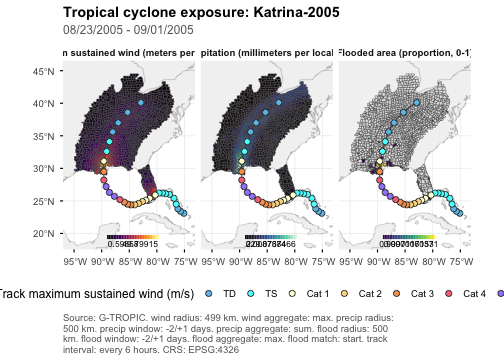
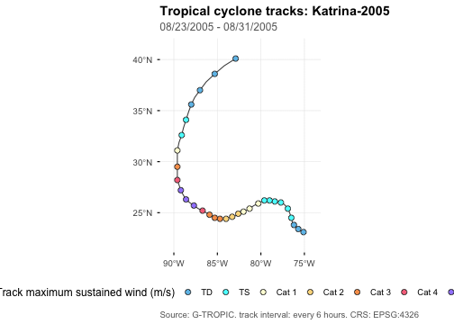

``` r
library(gtropic)
library(dplyr)
#> 
#> Attaching package: 'dplyr'
#> The following objects are masked from 'package:stats':
#> 
#>     filter, lag
#> The following objects are masked from 'package:base':
#> 
#>     intersect, setdiff, setequal, union
```

`gtropic_plot()` turns tables already returned by `gtropic_data()` into static
exposure maps, exposure-count maps, and storm-track maps. It also creates
interactive exposure and count maps. Plotting never retrieves missing tables or
recomputes published exposure values and storm distances.

## Katrina, 2005

This vignette uses the United States records for Hurricane Katrina. Request the
geometry and track tables with the exposure data because plotting only uses
tables already present in the retrieval result.


``` r
katrina <- gtropic_data(
  STORM_NAME = "Katrina-2005",
  WHO_ENTITY = "United States",
  date_range = c(2005, 2005),
  tables = c("wind", "precip", "flood", "adm2", "geometry", "tracks")
)
#> Discovering datasets in collection "gtropic".
#> Downloading 'metadata/adm2.parquet'.
#> Downloading '02_wind/storm_metadata/2005.parquet'.
#> Retrieving 8 files (141.3 MB) ; .
#> Downloading '02_wind/exposures/2005.parquet'.
#> Downloading '02_wind/zero_pairs/2005.parquet'.
#> Downloading '04_precip/2005.parquet'.
#> Downloading '03_flood/2005.parquet'.
#> Downloading '02_wind/storm_tracks/2005.parquet'.
#> Downloading 'metadata/adm2_geometry_simplified.parquet'.
```


``` r
katrina$wind <- katrina$wind |> filter(STORM_DIST_KM <= 500)
```

`gtropic_exposures()` lists published metrics, units, and default aggregations.
Use it to select metrics appropriate to an analysis rather than inferring their
meaning from column names alone.


``` r
unname(vapply(gtropic_exposures(), nrow, integer(1)))
#> [1] 6 1 3
```

## Static maps

An exposure map summarizes a selected published metric for each ADM2.


``` r
gtropic_plot(
  katrina,
  type = "exposure",
  metric = c("VMAX_SUST_MS", "PRECIP_MM", "PROP_FLOODED_AREA"),
)
```



Count maps apply metric thresholds before counting distinct storms or local
exposure days. The automatic caption records the selected definitions.


``` r
gtropic_plot(
  katrina,
  type = "count",
  metric = "VMAX_SUST_MS",
  count_unit = "days",
  storm = "Katrina-2005",
  basemap = "none",
  gridlines = FALSE
)
```


`metric`, `aggregate`, `palette`, and `direction` accept vectors aligned by
position. This makes a panel for each selected metric while preserving a
separate, hazard-appropriate scale for every panel.


``` r
gtropic_plot(
  katrina,
  type = "exposure",
  metric = c("VMAX_SUST_MS", "PRECIP_MM"),
  aggregate = c("max", "sum"),
  palette = c("inferno", "mako"),
  direction = c(1, 1),
  storm = "Katrina-2005",
  track = FALSE,
  basemap = "none"
)
```


## Storm tracks

Track maps use the published `USA_WIND` observations. By default, their points
are classified with `saffir_simpson()`, which returns the conventional
Saffir-Simpson category key in metres per second. Supply a compatible data frame
to `track_map_key` to use a different classification, and use `track_interval`
to sample displayed points at three- or six-hour UTC intervals while retaining
the complete path.


``` r
gtropic_plot(
  katrina,
  type = "track",
  storm = "Katrina-2005",
  track_map_key = saffir_simpson(),
  track_interval = 6,
  basemap = "none"
)
```



## Interactive maps

Set `interactive = TRUE` for a Leaflet exposure or count map. Interactive maps
use vector layers and do not require a tile-server API key. Static gridlines do
not apply to this output because Leaflet maps have no plot axes.


``` r
gtropic_plot(
  katrina,
  type = "exposure",
  metric = "VMAX_SUST_MS",
  storm = "Katrina-2005",
  interactive = TRUE,
  basemap = "none"
)
```

## Saving plots

Static calls return ggplot objects, which can be extended with ggplot2 layers
and saved with `gtropic_save()` when the analysis is ready for publication.


``` r
p <- gtropic_plot(
  katrina,
  type = "exposure",
  metric = "VMAX_SUST_MS",
  storm = "Katrina-2005",
  basemap = "none"
) + theme_gtropic(base_size = 11)

gtropic_save(p, "katrina-wind-exposure.png", dpi = 300)
```
